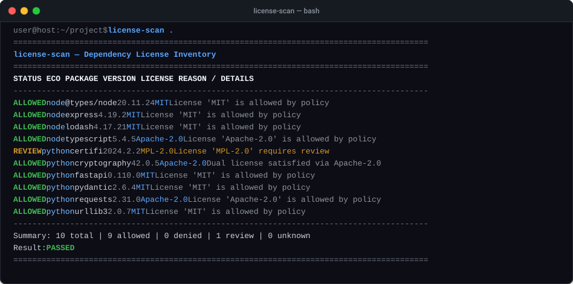

# license-scan

[](https://github.com/YusufBeratZengin/license-scan/actions/workflows/ci.yml)
[](https://pypi.org/project/license-scan/)
[](https://www.python.org/downloads/)
[](https://opensource.org/licenses/MIT)

**[English](README.md)** | **[Türkçe](README.tr.md)**

> Node.js ve Python projeleri için sıfır bağımlılıklı, çevrimdışı bağımlılık lisans envanteri ve CI uyumluluk denetleyicisi.

<p align="center">
  
</p>

## Neden license-scan?

- **Sıfır Çalışma Zamanı Bağımlılığı ve %100 Çevrimdışı:** Yalnızca Python standart kütüphanesini (`>=3.10`) kullanır. Sıfır ağ çağrısı yapar, telemetri göndermez; API anahtarı, jeton veya üçüncü taraf SaaS aboneliği gerektirmez.
- **Çoklu Ekosistem ve AST Tabanlı SPDX İfade Çözümleyici:** Node.js (`package-lock.json` v1/v2/v3, `node_modules`) ve Python (`importlib.metadata`, PEP 639) ortamlarını tek çatı altında birleştirir. Mantıksal SPDX ifadelerini (`AND`, `OR`, `WITH` ve iç içe parantezler) AST düzeyinde ayrıştırarak çift lisanslama seçeneklerini doğru çözer.
- **Otomatik CI Denetimi ve Lisans Atıf Üretimi:** Bağımlılıkları kural tabanlı politikalara (`allow`, `deny`, `review` ve gerekçeli paket `exceptions`) göre değerlendirir, uyumsuzluk tespitinde CI kapılarını çıkış kodu `1` ile durdurur ve yayınlamaya hazır atıf dosyaları (`NOTICE` / `THIRD_PARTY`) üretir.

---

## Hızlı Başlangıç

### 1. Kurulum

Pip ile yükleyin:

```bash
pip install license-scan
```

Veya doğrudan kurulum yapmadan çalıştırın (Python 3.10+ gereklidir):

```bash
python -m license_scan --help
```

### 2. Politika Dosyası Oluşturma

Deponuzda başlangıç için varsayılan bir `license-scan.json` şablonu oluşturun:

```bash
license-scan --init-policy
```

### 3. Çalışma Alanını Tarama

Geçerli dizindeki tüm Node.js ve Python bağımlılıklarını taramak için:

```bash
license-scan .
```

### 4. Yalnızca Canlı Dağıtım Paketlerini İnceleme

Geliştirme bağımlılıklarını (`devDependencies`) dışarıda bırakmak için:

```bash
license-scan . --prod
```

### 5. Atıf (NOTICE) Dosyası Üretme

Üçüncü taraf bileşenlerin lisans ve telif metinlerini içeren bir `NOTICE` dosyası oluşturmak için:

```bash
license-scan . --notice -o NOTICE
```

---

## Kullanım Örnekleri

### CI Ortamlarında Katı Denetim

Sürekli entegrasyon süreçlerinde, inceleme gerektiren (`REVIEW`) veya tanımlanamayan (`UNKNOWN`) lisansların da süreci durdurması (çıkış kodu `1`) için `--strict` seçeneğini kullanın:

```bash
license-scan . --prod --strict
```

### Belirli Bir Ekosistemi Hedefleme

Yalnızca Node.js veya Python paketlerini incelemek için:

```bash
# Yalnızca Node.js
license-scan ./package-lock.json -e node

# Yalnızca Python
license-scan . -e python
```

### Harici veya İzole Bir Sanal Ortamı Tarama

Doğrudan belirli bir `site-packages` dizinini belirtebilirsiniz:

```bash
license-scan . --site-packages .venv/lib/python3.11/site-packages
```

### Makine Tarafından Okunabilir Raporlar Üretme

Denetimler için JSON, CSV veya Markdown formatında çıktılar alın:

```bash
# JSON raporu
license-scan . -f json -o compliance-report.json

# CSV çıktısı
license-scan . -f csv -o licenses.csv

# PR açıklamaları için Markdown raporu
license-scan . -f markdown -o report.md
```

### Komut Satırı Seçenekleri

```text
kullanım: license-scan [-h] [-p DOSYA] [-e {all,node,python}]
                       [-f {table,json,csv,markdown,notice}] [-o DOSYA]
                       [--site-packages DIZIN] [--prod] [--strict] [--notice]
                       [--init-policy] [-v] [-q]
                       [yol]

konumsal argümanlar:
  yol                   Taranacak dizin, package-lock.json veya site-packages yolu (varsayılan: geçerli dizin).

seçenekler:
  -h, --help            Yardım mesajını görüntüler ve çıkar.
  -p, --policy DOSYA    Politika dosyası yolu (varsayılan: license-scan.json).
  -e, --ecosystem {all,node,python}
                        Taranacak ekosistem (varsayılan: all).
  -f, --format {table,json,csv,markdown,notice}
                        Çıktı formatı (varsayılan: table).
  -o, --output DOSYA    Çıktıyı ekrana basmak yerine belirtilen dosyaya yazar.
  --site-packages DIZIN Python site-packages dizinini doğrudan belirtir.
  --prod, --no-dev      Geliştirme bağımlılıklarını (devDependencies) hariç tutar.
  --strict              REVIEW veya UNKNOWN durumundaki lisansları hata kabul eder (çıkış kodu 1).
  --notice              NOTICE / THIRD_PARTY atıf dosyası formatında çıktı üretir.
  --init-policy         Varsayılan bir license-scan.json dosyası oluşturur ve çıkar.
  -v, --version         Sürüm numarasını görüntüler ve çıkar.
  -q, --quiet           Bilgilendirme çıktılarını gizler.
```

---

## Politika Yapılandırması (`license-scan.json`)

`license-scan` aracı geçerli dizinde `license-scan.json` (veya `.license-scan.json`) dosyasını arar; istenirse `-p / --policy` ile özel bir dosya verilebilir.

```json
{
  "$schema": "https://raw.githubusercontent.com/YusufBeratZengin/license-scan/main/schema.json",
  "allow": [
    "MIT",
    "Apache-2.0",
    "BSD-3-Clause",
    "BSD-2-Clause",
    "ISC",
    "0BSD",
    "CC0-1.0",
    "Unlicense",
    "PSF-2.0",
    "Zlib"
  ],
  "deny": [
    "GPL-1.0*",
    "GPL-2.0*",
    "GPL-3.0*",
    "AGPL-1.0*",
    "AGPL-3.0*",
    "SSPL-1.0*",
    "CPAL-1.0*",
    "OSL-3.0*"
  ],
  "review": [
    "MPL-2.0",
    "LGPL-2.1*",
    "LGPL-3.0*",
    "EPL-1.0",
    "EPL-2.0",
    "EUPL-1.2"
  ],
  "allow_unknown": false,
  "exceptions": {
    "dahili-derleme-araci": {
      "license": "GPL-3.0-only",
      "reason": "Yalnızca şirket içi yerel derleme adımında kullanılır; son kullanıcıya dağıtılmaz."
    }
  }
}
```

### Politika Değerlendirme Kuralları

1. **Önce İstisnalar:** Paket adı `exceptions` listesinde kayıtlıysa ve lisans kısıtlamasını sağlıyorsa paket doğrudan `ALLOWED` olarak onaylanır.
2. **Yasaklı Listesi Önceliği:** `deny` listesiyle eşleşen (joker karakter `GPL-*` desteklenir) lisanslar `DENIED` sayılır.
3. **İnceleme Listesi:** `review` listesinde tanımlanan lisanslar `REVIEW` durumuna geçer.
4. **İzin Verilenler:** `allow` listesinde bulunan lisanslar `ALLOWED` olarak onaylanır.
5. **SPDX İfadeleri:**
   - **`OR` (Çift Lisanslama):** Seçeneklerden en az biri `ALLOWED` ise paket kabul edilir.
   - **`AND` (Bileşik Lisans):** Bileşenlerin tümünün uyumlu olması gerekir. Herhangi bir dal `DENIED` ise paket reddedilir.
6. **Çıkış Kodları:** Herhangi bir paket reddedilirse (veya `--strict` etkin iken `REVIEW`/`UNKNOWN` varsa) çıkış kodu `1` döner.

---

## Sürekli Entegrasyon (CI)

### GitHub Actions

`.github/workflows/ci.yml` dosyanıza lisans denetimi adımı ekleyin:

```yaml
name: Lisans Denetimi

on:
  push:
    branches: [main]
  pull_request:
    branches: [main]

jobs:
  license-check:
    runs-on: ubuntu-latest
    steps:
      - uses: actions/checkout@v4
      - name: Python Kurulumu
        uses: actions/setup-python@v5
        with:
          python-version: "3.11"
      - name: Bağımlılıkları Yükle
        run: |
          npm ci --production
      - name: Lisans Uyumluluğunu Denetle
        run: |
          python -m license_scan . --prod --strict
```

### GitLab CI

```yaml
license_scan:
  stage: test
  image: python:3.11-slim
  script:
    - python -m license_scan . --strict
```

---

## SSS ve Kısıtlamalar

### license-scan internet üzerinden proje veya paket verisi gönderir mi?
Hayır. `license-scan` %100 çevrimdışı (offline) çalışır. Harici paket depolarına, uzak API'lere veya telemetri sunucularına hiçbir veri göndermez.

### Hangi kilit dosyaları ve paket yöneticileri desteklenir?
- **Node.js:** `package-lock.json` (sürüm 1, 2 ve 3) ile doğrudan `node_modules` dizini (kapsamlı `@org/paket` yapıları ve gömülü `LICENSE` dosya analizi dahil).
- **Python:** Standart `importlib.metadata` ile kurulu paket ortamları (`License`, PEP 639 `License-Expression`, Trove sınıflandırıcıları ve `.dist-info` lisans dosyaları).

### Çift lisanslama (`OR`) nasıl değerlendirilir?
Bir paket `(MIT OR GPL-3.0-only)` gibi çift lisans belirttiğinde, açık kaynak dünyasındaki kullanıcı seçim hakkına paralel olarak politikanızda izin verilen en az bir seçenek varsa paket uyumlu kabul edilir.

### Kısıtlamalar nelerdir?
- `license-scan` yerel kilit dosyalarını ve kurulu paketleri inceler; kurulu olmayan veya kilit dosyası bulunmayan yalın `requirements.txt` gibi çözümlenmemiş bağımlılık dosyalarını çözemez.
- `license-scan` bir geliştirici uyumluluk aracıdır; hukuki danışmanlık yerine geçmez.

---

## Katkıda Bulunma

Hata bildirimleri, öneriler ve katkılar memnuniyetle karşılanır!

1. Depoyu forklayın ve yerel ortamınıza klonlayın.
2. Test bağımlılıklarını kurun:
   ```bash
   pip install -e .[test]
   ```
3. Testleri kapsam raporuyla çalıştırın:
   ```bash
   pytest --cov
   ```
4. Kod stilini ve tip denetimini doğrulayın:
   ```bash
   ruff check src tests
   mypy src
   ```

Ayrıntılı yönergeler için lütfen [CONTRIBUTING.md](CONTRIBUTING.md) belgesine bakın.

---

## Lisans

Bu proje MIT Lisansı ile lisanslanmıştır. Ayrıntılar için [LICENSE](LICENSE) dosyasına bakabilirsiniz.

Copyright (c) 2026 Yusuf Berat Zengin.
